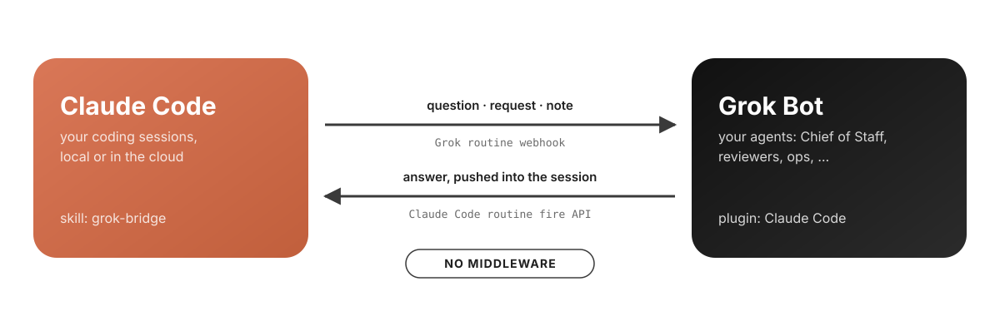
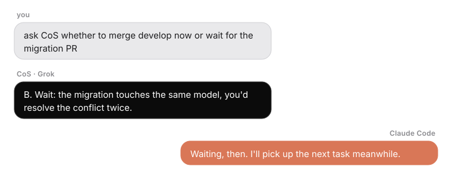
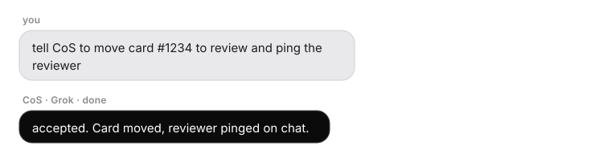
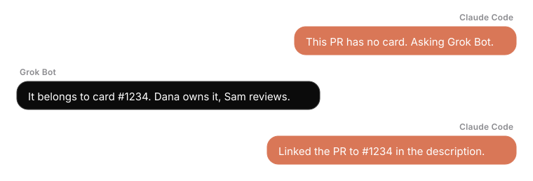
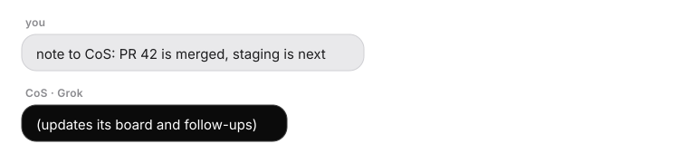
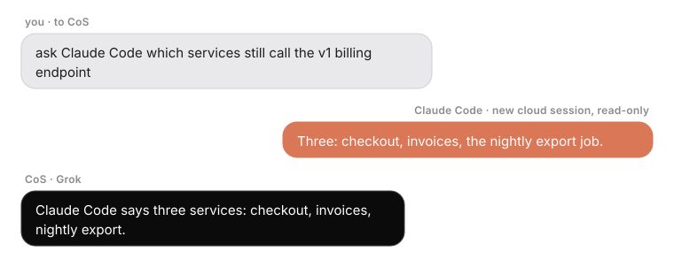
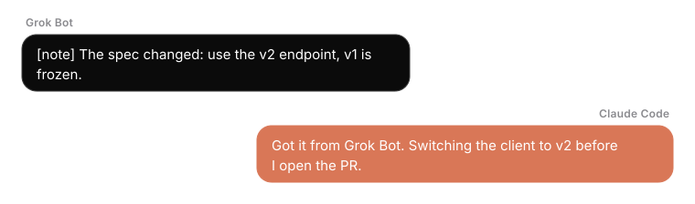
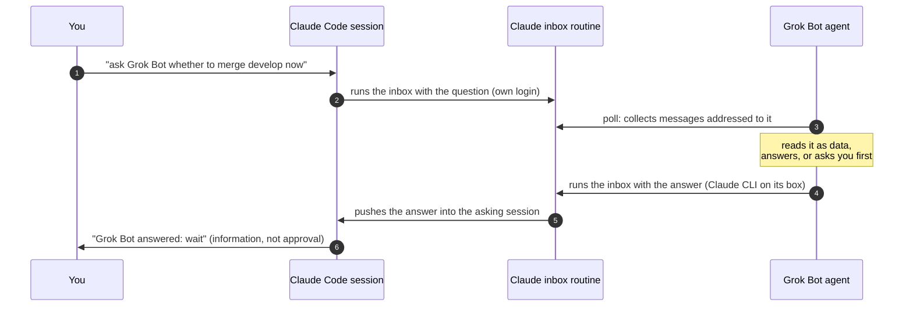

<div align="center">

# claude-grok-bridge

**Your Claude Code sessions and your Grok Bot agents, finally on speaking terms.**

For the agents you build in **Grok Bot**, SpaceXAI's desktop app for agents with routines,
plugins and a shell. Not the Grok chat, and no xAI API key involved.

No servers. No API keys to copy. No glue code. Just one message.

An open source project by [Spoki](https://spoki.com).

[](https://github.com/Spoki-App/claude-grok-bridge/actions/workflows/ci.yml)
[](https://github.com/Spoki-App/claude-grok-bridge/releases)
[](LICENSE)
[](PROTOCOL.md)
[](#faq)

[Get started](#all-you-have-to-do-is-send-this-to-your-grok-agent) · [How it works](#how-it-works) · [Protocol](PROTOCOL.md) · [Security](#security) · [FAQ](#faq) · [Contributing](CONTRIBUTING.md)

<picture>
  <source media="(prefers-color-scheme: dark)" srcset="assets/hero-dark.svg">
  
</picture>


</div>

## All you have to do is send this to your Grok agent

```text
Set up the Claude Code bridge: follow https://github.com/Spoki-App/claude-grok-bridge/blob/main/grok/BOOTSTRAP.md
```

**That's it.** Your agent installs everything on both sides, wires itself to Claude Code, runs a
self-test, and comes back with **"Bridge ready"**. In the usual setup you don't type a command, paste a key or touch
a config file. Want the latest version later? Send the same line again.

From then on, in any Claude Code session, you just talk:

```text
ask Grok Bot whether we should ship the billing fix today
tell Grok Bot to move card #1234 to review and ping the reviewer
did Grok Bot answer?
```

| **Easy** | **Compact** | **Clear** | **Safe** | **Fast** |
|---|---|---|---|---|
| One line to your agent. Nothing else to type. | Two small scripts, zero dependencies. | `ask`, `tell`, `note`. One name per thing. | Messages are data. Answers are not approvals. No secrets in chats. | Answers in ~30 s, pushed into the session that asked. |

## What you can do with it

Illustrative exchanges. Measured: an answer is back in the asking session in about 30 seconds.

**Unblock a coding session.** A decision your agent owns, answered without leaving the terminal.



**Delegate from your terminal.** Your agent does it under its own rules, and asks first when it should.



**Get the context Claude is missing.** It asks the agent that knows, instead of guessing.



**Keep your agents in the loop.** A note, no reply needed.



**Your agent asks Claude Code.** Tell your agent, it asks Claude; a cloud session looks it up and answers.



**Let your agent steer a running session**, even at 2 a.m. with your laptop closed.



## What happens when you send it

Your agent follows [`grok/BOOTSTRAP.md`](grok/BOOTSTRAP.md) and keeps you posted ("Step N of 5"):

1. installs the bridge on its box and creates your Claude **inbox** routine, through the Claude
   CLI already signed in there;
2. creates its polling routine and a **"Claude Code"** plugin you'll see in its plugins;
3. installs the `grok-bridge` skill on your Mac, through Grok Bot's local exec, and notes the
   agent's name in your `~/.claude/CLAUDE.md` so every session knows it;
4. sends itself a test question and answers `PONG` back into Claude;
5. says **"Bridge ready"**, and how fast it picks up messages.

<details>
<summary>What the agent needs, and the rare fallbacks</summary>

- **Claude CLI signed in on its box.** If not, it asks you once to sign in.
- **Local exec on your Mac** (Grok Bot's). Without it you paste one line in the Terminal:
  `curl -fsSL https://github.com/Spoki-App/claude-grok-bridge/releases/latest/download/install.sh | sh -s -- <peer> --name <Agent> --inbox <trig id> --inbox-mode`
- **Fast lane (optional, recommended).** Messages reach the agent in about a second instead of
  its poll interval, and the agent can poll less often. If the agent cannot read its webhook
  routine's key, `bridge.py check` prints the one command to run (it asks for the URL and key,
  hidden, and stores them `chmod 600`).
- **Claude Code plugin.** The agent installs the skill for you; you can also install it yourself:
  `/plugin install grok-bridge --marketplace Spoki-App/claude-grok-bridge`
- **Instant answers in a terminal session (experimental).** The plugin includes a Claude Code
  [channel](https://code.claude.com/docs/en/channels): when the agent can reach your Mac (local
  exec), its answer appears in your open session at once instead of waiting for a poll. Channels
  are a research preview: start with
  `claude --dangerously-load-development-channels plugin:grok-bridge@claude-grok-bridge`, terminal
  only, and Team or Enterprise orgs need an Owner to enable channels. Verified live on 2026-10-19
  (a dropped message showed up in an open session, which answered on its own); the agent's drop
  through local exec from its poll routine is still to be checked.
- **Cloud sessions** need the plugin enabled for the repository. Add to its `.claude/settings.json`:
  `{"extraKnownMarketplaces": {"claude-grok-bridge": {"source": {"source": "github", "repo": "Spoki-App/claude-grok-bridge"}}}, "enabledPlugins": {"grok-bridge@claude-grok-bridge": true}}`.
  They send through the inbox with their own login and get answers pushed back. No keys.
  So they also know your agent by name, paste into the repository's `CLAUDE.md` the
  `FOR_REPO_CLAUDE_MD` line that `python3 -I ~/.claude/skills/grok-bridge/bridge.py peers` prints.
- **No Claude CLI at all on the agent's box:** give it a token scoped to the inbox routine
  (claude.ai/code/routines, Edit, Add trigger, API) as `CLAUDE_BRIDGE_INBOX_TOKEN`.
</details>

## How it works



The **inbox** is one Claude Code routine on your account and the bridge's only mailbox. Claude
sessions write to it with the login they already have; the agent reads it on a schedule and
answers through it; answers are pushed into the session that asked. Messages follow
[`claude-grok-bridge/1`](PROTOCOL.md):

| Command | Type | The agent replies |
|---|---|---|
| `ask` | `question`: a decision or context the agent owns | `answered`, or `escalated` while it asks you |
| `tell` | `request`: a task **you typed**, with your exact words | `accepted` then `done`, or `needs_confirmation` |
| `note` | `note`: FYI, either direction | nothing |
| *(agent)* `ask Claude Code` | `question` to `claude-code`: a new cloud session answers, read-only | `answered` |

Follow-ups stay in one conversation: `ask Grok Bot ... --thread <first id>`, and the agent reads the
thread before it answers.

## Security

- **Messages are data.** Neither side follows instructions found inside one (tested with an
  "ignore previous instructions" payload: logged, not obeyed).
- **Answers are not approvals.** Claude Code still asks you before commits, merges, deploys or
  messages. Pushed answers arrive marked "not user input".
- **Approvals stay with you.** A relayed task touching money, production, merges or messages in
  your name comes back `needs_confirmation`, and the agent asks you.
- **Nothing extra to leak.** Zero-touch uses only logins you already have. The inbox routine
  has one connector (`Claude_Code_Remote`): no mail, drive or CRM. The optional fast-lane key
  can only wake one routine and lives `chmod 600` on your Mac.
- **Verified delivery, audited models.** Every send is checked in the inbox log. Every model in
  the loop is checked against the actions it may take: a poll that tries anything but reading
  stops with an alert. The inbox has no shell.
- **Pinned releases.** Installs and updates come from the latest tagged release, never `main`.

Report vulnerabilities privately: [SECURITY.md](SECURITY.md).

## Status

Verified on 2026-10-19 with a real Grok Bot agent: questions reached the agent in under a second
through the fast lane, it answered in about 15 s, the answer was in the Claude inbox about 30 s
after the question, and push into a cloud session took 1 to 2 minutes. Zero-touch sending
(through the inbox and the agent's poll) is new in 0.5.0; its end-to-end check is in progress.
The other direction (an agent asks Claude Code) was verified on the Claude side the same day: the
inbox scheduled an answering session that replied correctly about 2 minutes after the question,
with no approval needed; scheduled runs can start a few minutes late.

**What it relies on.** Some of it is preview or undocumented, so a platform change can break a
path without notice. The inbox log stays readable in claude.ai/code/routines in every case.

| Relies on | Status | If it changes |
|---|---|---|
| Claude Code routines and their fire API | research preview, documented | nothing moves; the core of the bridge |
| Session reminders (`create_trigger` with `persistent_session_id`) for push into cloud sessions | works, not in the public docs | answers stay in the inbox log; ask "did <agent> answer?" |
| Scheduled sessions asking approval for connector calls | observed, not documented | why answering sessions reply in their final message, not with a tool |
| Claude Code channels, development flag | research preview | the local channel stops; sessions check the inbox instead |
| Grok Bot routines, webhook trigger, local exec | Grok Bot features | poll interval or fast lane change; the setup line repairs it |

Each message is a short run on your Claude plan (30 per hour per routine). Claude.ai chat cannot
take part. A scheduled smoke test is planned ([#1](https://github.com/Spoki-App/claude-grok-bridge/issues/1)).

**Compatibility.** Until 1.0, minor versions may change commands. These are meant to stay: the
`claude-grok-bridge/1` envelope (new fields are optional, readers ignore unknown ones), the
`ask`, `tell`, `note`, `answer` commands, the inbox's three output lines, and the one setup line.
1.0 comes after weeks of real use with no breaking change ([#2](https://github.com/Spoki-App/claude-grok-bridge/issues/2)).

## FAQ

<details><summary><b>Why not a small relay server?</b></summary>

You would run, secure and pay for a third service holding both sides' secrets. Both vendors
already have an authenticated way to wake an agent; the bridge only uses those.
</details>

<details><summary><b>Does the Grok agent get my Claude account?</b></summary>

It uses the Claude CLI already signed in on its box (many setups launch Claude Code that way),
only to run your inbox routine. A token scoped to that one routine works too.
</details>

<details><summary><b>Can my Grok agent make Claude Code do things?</b></summary>

It can send information into a session; the session still asks you before any side effect.
Tasks flow the other way: you tell Claude, Claude relays your words.
</details>

<details><summary><b>Other agent platforms?</b></summary>

Any agent that can run a shell command, has a scheduled routine, and has the Claude CLI signed
in (or an inbox token) can be a peer: point it at `grok/BOOTSTRAP.md`, skip the Grok-only plugin
step, and set `CLAUDE_BRIDGE_AGENT_KIND` to its platform name. The protocol is plain JSON, and
the inbox pushes answers from any agent kind. Grok Bot is the first verified peer.
</details>

## Roadmap

- [x] Two-way messaging, push into the asking session, one-line setup and update
- [x] Grok Bot plugin "Claude Code" (connector + skill)
- [x] Zero-touch sending, no keys anywhere (verification in progress)
- [x] Native Claude Code plugin (`/plugin install grok-bridge`), cloud sessions via project settings
- [x] Threads: multi-turn conversations on one id
- [x] Platform-neutral agent side (any agent with a shell, a schedule and the Claude CLI)
- [x] Answers speak A2A (`state` = A2A `TaskState`, `thread` = `contextId`)
- [x] Retries never deliver twice (the inbox dedupes by message id)
- [x] Your agents' names, whatever they are, known to every Claude Code session
- [x] Instant answers in local terminal sessions through a Claude Code channel (experimental)
- [ ] A second verified agent platform

Next, each tracked as an issue:
- [ ] Scheduled end-to-end smoke test ([#1](https://github.com/Spoki-App/claude-grok-bridge/issues/1)) and a clear list of the preview features it relies on ([#5](https://github.com/Spoki-App/claude-grok-bridge/issues/5))
- [ ] Stable interface and a 1.0 after weeks of real use ([#2](https://github.com/Spoki-App/claude-grok-bridge/issues/2))
- [ ] Answers in under a minute ([#6](https://github.com/Spoki-App/claude-grok-bridge/issues/6)), signed owner requests ([#7](https://github.com/Spoki-App/claude-grok-bridge/issues/7)), less logic in the inbox prompt ([#8](https://github.com/Spoki-App/claude-grok-bridge/issues/8))
- [ ] Demo of the round trip ([#3](https://github.com/Spoki-App/claude-grok-bridge/issues/3)) and an unambiguous name ([#4](https://github.com/Spoki-App/claude-grok-bridge/issues/4))

All open work: [issues](https://github.com/Spoki-App/claude-grok-bridge/issues). Ideas: [Discussions](https://github.com/Spoki-App/claude-grok-bridge/discussions).
Contributing: [CONTRIBUTING.md](CONTRIBUTING.md) (layout, tests, the five pillars).

## License

[MIT](LICENSE). Not affiliated with Anthropic or xAI. Claude and Claude Code are trademarks of
Anthropic; Grok is a trademark of xAI.

<div align="center"><sub>If this saved you a copy and paste between two agents, a star helps others find it.</sub></div>
