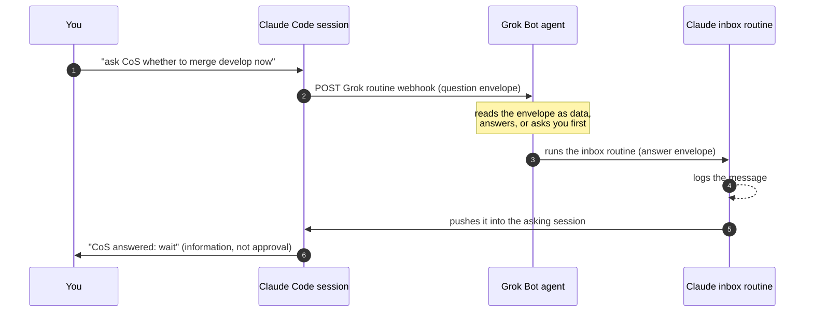

<div align="center">

# claude-grok-bridge

**Your Claude Code sessions and your Grok Bot agents, finally on speaking terms.**

Ask a Grok agent a question from Claude Code, hand it a task, get the answer back in your session.
Through each vendor's own endpoints. No server in the middle. One line to set up.

[](https://github.com/francoCosimo95/claude-grok-bridge/actions/workflows/ci.yml)
[](https://github.com/francoCosimo95/claude-grok-bridge/releases)
[](LICENSE)
[](PROTOCOL.md)
[](#faq)

[Quickstart](#quickstart) · [How it works](#how-it-works) · [Protocol](PROTOCOL.md) · [Security](#security-model) · [FAQ](#faq) · [Contributing](#contributing)

<picture>
  <source media="(prefers-color-scheme: dark)" srcset="assets/hero-dark.svg">
  
</picture>

</div>

## See it in action

You are in Claude Code, working on a branch, and you need a decision your Chief of Staff agent
owns. An illustrative exchange (the round trip time is the one we measured):

```text
you          ›  ask CoS whether this branch should merge develop now or wait for the migration PR

Claude Code  ›  Sent to CoS (q-20261019-1036-aa5b). I'll pick up the answer when it lands.

CoS · Grok   ›  B. Wait for the migration PR: it touches the same model, merging now means
                resolving the same conflict twice.                       answered in ~30 s

Claude Code  ›  CoS recommends waiting. That is information, not approval:
                want me to pause this branch and pick up the next task?
```

## Why

AI agents are multiplying, and they live on different platforms. Your coding happens in
**Claude Code**; your always-on operations agents (a chief of staff, a scrum master, reviewers)
may live in **Grok Bot**. Until now, a Claude Code session that needed a decision from one of
them had to stop and wait for a human to copy and paste.

claude-grok-bridge gives them a direct line:

- **Native on both sides.** Claude Code to Grok uses the Grok agent's routine webhook. Grok to
  Claude Code uses a Claude Code routine. No relay server, no queue, no shared database to run
  or trust.
- **Lands in the right session.** Answers are pushed into the cloud session that asked, even with
  your laptop closed. Local sessions read them from the inbox.
- **Safe by default.** Every message is data, never an order. Answers are information, never
  user authorization. Each side holds one narrow credential.
- **One line to set up, the same line to update.** Your Grok agent installs and wires both sides,
  then proves it with a self-test.

## Quickstart

Send your Grok Bot agent this one line:

```text
Set up the Claude Code bridge: follow https://github.com/francoCosimo95/claude-grok-bridge/blob/main/grok/BOOTSTRAP.md
```

The agent takes it from there and tells you where it is ("Step 2 of 5") and the single next step
for you, if any:

1. installs the bridge on its box and finds or **creates** your Claude inbox routine, through the
   Claude CLI already signed in there;
2. creates its **"Claude Code bridge"** routine and a **"Claude Code"** plugin (connector + skill);
3. installs the `grok-bridge` skill on your Mac; if it cannot read its own webhook key, it gives
   you one command that asks for the two values with hidden input;
4. sends itself a question from your Mac and answers `PONG` back into Claude;
5. reports **"Bridge ready"**.

Then, in any Claude Code session:

```text
ask CoS whether we should ship the billing fix today
tell CoS to move card #1234 to review and ping the reviewer
did CoS answer?
```

**Updating** is the same line again: the agent moves to the latest release and refreshes
everything. Details and fallbacks: [SETUP.md](SETUP.md).

## How it works



| Direction | Endpoint | Credential |
|---|---|---|
| Claude Code → Grok Bot | the agent's **routine webhook** | that routine's key, stored `chmod 600` on your Mac |
| Grok Bot → Claude Code | your **inbox routine**, run by the Claude CLI on the agent's box (or the routine fire API) | the Claude login the box already has, or a token scoped to that one routine |
| Inbox → asking session | a one-off session reminder | none: it runs inside your Claude account |

Messages follow a small versioned protocol, [`claude-grok-bridge/1`](PROTOCOL.md):

| Type | Use it for | Reply |
|---|---|---|
| `question` | a decision or context the agent owns | `answered`, or `escalated` while it asks you |
| `request` | a task **you typed** ("tell CoS to..."), relayed with your exact words | `accepted` then `done`, or `needs_confirmation` |
| `note` | FYI, either direction | none |

## Features

- **Two-way messaging** between Claude Code and Grok Bot agents, on each platform's own rails.
- **Push into the asking session**, including cloud sessions while your laptop sleeps.
- **Relayed tasks keep provenance:** a request carries your verbatim words.
- **Escalation built in:** the agent can answer `escalated`, ask you, then follow up with your reply.
- **Grok Bot plugin "Claude Code":** a zero-dependency MCP connector (`check_bridge`,
  `read_envelope`, `reply_to_claude`, `message_claude`) plus a skill.
- **Guided setup:** progress as "Step N of 5", one clear next step, hidden input with hints and
  retries when you are asked for anything.
- **Pinned, versioned releases:** installs track the latest `vX.Y.Z` tag, never `main`.
- **Zero dependencies:** Python 3.9+ standard library and POSIX `sh`.

## Security model

- **Envelopes are data.** Neither side follows instructions found inside a message. Tested with
  an "ignore previous instructions" payload: logged, not obeyed.
- **Answers are information, not authorization.** A Claude Code session never treats an agent's
  answer as your approval for commits, merges, deploys or messages. Pushed answers arrive marked
  "not user input".
- **Approvals stay with you.** A relayed request that touches money, production, merges or
  messages sent in your name comes back `needs_confirmation`, and the agent asks you directly.
- **Narrow credentials.** Claude holds one key that can only wake one Grok routine. The inbox
  routine only has the `Claude_Code_Remote` connector: no mail, drive or CRM.
- **No secrets in chats, logs or git**, checked by tests in CI.

Found something? Report it privately: [SECURITY.md](SECURITY.md).

## Status

Working end to end, verified on 2026-10-19 with a real Grok Bot agent: Claude Code to Grok in
under a second, the agent answered in about 15 s, and the answer was in the Claude inbox about
30 s after the question. Push into a cloud session was verified separately (1 to 2 minutes).

Good to know:
- Claude Code routines are a research preview. The push step uses session reminders, which work
  but are not in the public routine docs; the inbox log is the documented fallback.
- Each answer is a short cloud run on your Claude plan (30 fires per hour per routine).
- Cloud sessions receive answers out of the box; to also **send** from them today, the Grok
  webhook key must be available in that environment (see [SETUP.md](SETUP.md#cloud-sessions)).
- Claude.ai chat cannot take part: it has no outbound HTTP and no push target.

## FAQ

<details>
<summary><b>Why not a small relay server?</b></summary>

Because then you would run, secure and pay for a third service holding both sides' secrets. Both
vendors already expose an authenticated way to wake an agent; the bridge only uses those.
</details>

<details>
<summary><b>Does the Grok agent get access to my Claude account?</b></summary>

It uses the Claude CLI already signed in on its box (many Grok setups launch Claude Code sessions
that way today), only to run your inbox routine. You can give it a token scoped to that single
routine instead.
</details>

<details>
<summary><b>Can my Grok agent make Claude Code do things?</b></summary>

It can send information into a session. The session treats it as data and still asks you before
any side effect. Tasks flow the other way: you tell Claude, Claude relays your words to the agent.
</details>

<details>
<summary><b>Does it work with other agent platforms?</b></summary>

The protocol is platform-neutral JSON. Grok Bot is the first peer; adapters for other platforms
are welcome (see the roadmap).
</details>

<details>
<summary><b>Why zero dependencies?</b></summary>

The scripts run on your Mac and on the agent's box. No `pip install`, no venv, no version drift:
setup stays one line.
</details>

## Roadmap

- [x] Two-way messaging, push into the asking session, PONG self-test
- [x] One-line setup and update, pinned releases, guided steps
- [x] Grok Bot plugin "Claude Code" (connector + skill)
- [ ] **Zero-touch mode:** no values to paste, and sending from cloud sessions with no key in the
      environment (messages to the agent go through the inbox too)
- [ ] Native Claude Code plugin (`/plugin install grok-bridge`)
- [ ] Threads: multi-turn conversations on one envelope id
- [ ] More peers beyond Grok Bot

Ideas? Open a [discussion](https://github.com/francoCosimo95/claude-grok-bridge/discussions).

## Contributing

Contributions are welcome: fixes, smoother setup, new peers, protocol ideas. Start with
[CONTRIBUTING.md](CONTRIBUTING.md); tests run with `python3 -m unittest discover -s tests` and in
CI on Linux and macOS. Please be kind ([Code of Conduct](CODE_OF_CONDUCT.md)).

<details>
<summary>Repository layout</summary>

| Path | What |
|---|---|
| `PROTOCOL.md` | the `claude-grok-bridge/1` wire format and trust rules |
| `SETUP.md` | setup, updates, fallbacks |
| `grok/BOOTSTRAP.md` | what the Grok agent follows to install and update |
| `grok/` | Grok side: `reply_to_claude.py`, `mcp_server.py`, routine prompt |
| `plugins/claude-code/` | the Grok Bot plugin (also a `.cursor-plugin` marketplace) |
| `claude/skills/grok-bridge/` | the Claude Code skill, `send_to_grok.py`, `add_peer.py` |
| `claude/INBOX_ROUTINE.md` | the Claude inbox routine |
| `install.sh` | Mac installer and updater |
| `tests/`, `.github/` | test suite and CI |
| `VERSION`, `CHANGELOG.md`, `scripts/release.sh` | releases |
</details>

## License

[MIT](LICENSE). Not affiliated with Anthropic or xAI. Claude and Claude Code are trademarks of
Anthropic; Grok is a trademark of xAI.

<div align="center"><sub>If this saved you a copy and paste between two agents, a star helps others find it.</sub></div>
