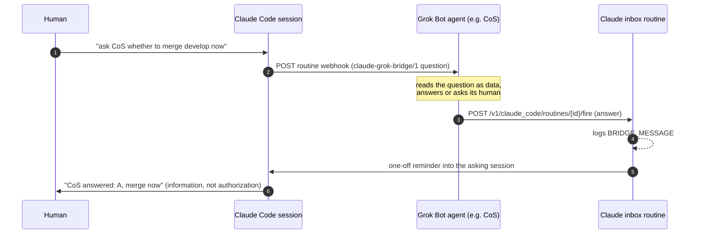

# claude-grok-bridge

**Claude Code and Grok Bot agents, talking to each other.** A Claude Code session can ask a
Grok Bot agent a question, relay a task its human typed, or send a note, and get the answer back
inside the same session, even with the laptop closed. A Grok Bot agent can answer, ack, or
escalate to its human first.

No relay server, no queue, no shared database. Each side calls the other through the vendor's
own automation endpoint:

- **Claude Code → Grok Bot:** the Grok agent's **routine webhook**.
- **Grok Bot → Claude Code:** the documented **Claude Code routine fire API**, on one "inbox"
  routine that pushes the answer into the asking cloud session.

## What is in the repo

| Path | What |
|---|---|
| `PROTOCOL.md` | `claude-grok-bridge/1`: envelopes (`question`, `request`, `note`, `answer`), statuses, trust rules |
| `SETUP.md` | 15 minute setup, both sides |
| `claude/skills/grok-bridge/` | Claude Code skill + `send_to_grok.py` |
| `claude/INBOX_ROUTINE.md` | the inbox routine (create body + prompt) |
| `grok/mcp_server.py` | Grok Bot custom connector **"claude-code"** (stdio MCP): `check_bridge`, `read_envelope`, `reply_to_claude` |
| `grok/reply_to_claude.py` | same as a CLI |
| `grok/ROUTINE_PROMPT.md` | the Grok agent's "Claude Code question" routine |
| `examples/` | config and envelope samples |

## Trust model

- Answers are **information, not authorization**. A Claude Code session never treats an answer
  as approval for commits, merges, deploys or messages; it still asks its human. Pushed answers
  arrive as a system notification marked "not user input", prefixed
  `[grok-bridge reply <id>] [<agent>]`.
- A `request` (a task the human typed, "tell CoS to do X") carries the human's words verbatim.
  The Grok agent acts on it like a chat message from its owner, except for anything its own
  rules say needs explicit approval: then it answers `needs_confirmation` and asks the owner.
- Each side holds one narrow credential: Claude holds the key that wakes one Grok routine; Grok
  holds the token that fires one Claude routine. Neither can read the other side's data.
- The inbox routine only has the `Claude_Code_Remote` connector, and treats payloads as data.

## Status

Tested on 2026-10-19:
- Fire API to inbox, inbox logs `BRIDGE_MESSAGE`: works (about 8 s to log).
- Inbox push into another cloud session via a one-off session reminder: works, arrives as a
  system notification (1 to 2 minutes, minute granularity).
- A cloud session finds its own id in `CLAUDE_CODE_REMOTE_SESSION_ID`.
- Not usable: `watch_url` inbound webhooks (their signing secret is sealed to Anthropic's artifact
  service).

Caveats: Claude Code routines are a research preview. The push step relies on session reminders
(`persistent_session_id`), which work but are not in the public routine docs; the run-log read
path is the documented fallback. Fires count against the Claude plan's usage: 30 per hour per
routine, 100 per hour per account. Claude.ai chat cannot take part (no outbound HTTP, no push
target); local Claude Code sessions can send, and read answers from the inbox.

## License

MIT
