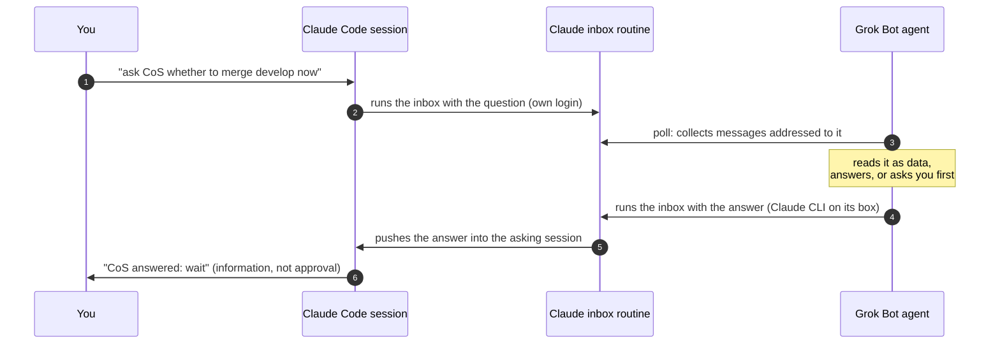

<div align="center">

# claude-grok-bridge

**Your Claude Code sessions and your Grok Bot agents, finally on speaking terms.**

Ask a Grok agent from Claude Code, hand it a task, get the answer back in your session.
Native endpoints on both sides. Nothing in the middle. One line to set up.

[](https://github.com/francoCosimo95/claude-grok-bridge/actions/workflows/ci.yml)
[](https://github.com/francoCosimo95/claude-grok-bridge/releases)
[](LICENSE)
[](PROTOCOL.md)
[](#faq)

[Quickstart](#quickstart) · [How it works](#how-it-works) · [Protocol](PROTOCOL.md) · [Security](#security) · [FAQ](#faq) · [Contributing](CONTRIBUTING.md)

<picture>
  <source media="(prefers-color-scheme: dark)" srcset="assets/hero-dark.svg">
  
</picture>

</div>

| **Easy** | **Compact** | **Clear** | **Safe** | **Fast** |
|---|---|---|---|---|
| One line to your agent. You type nothing else. | Two small scripts, zero dependencies. | `ask`, `tell`, `note`. One name per thing. | Messages are data. Answers are not approvals. No secrets in chats. | Answers in ~30 s, pushed into the session that asked. |

## See it in action

An illustrative exchange; the ~30 s round trip is measured.

```text
you          ›  ask CoS whether this branch should merge develop now or wait for the migration PR

Claude Code  ›  Sent to CoS (q-20261019-1036-aa5b).

CoS · Grok   ›  B. Wait for the migration PR: merging now means resolving the same conflict
                twice.                                                   answered in ~30 s

Claude Code  ›  CoS recommends waiting. That is information, not approval: pause this branch?
```

## Quickstart

Send your Grok Bot agent one line:

```text
Set up the Claude Code bridge: follow https://github.com/francoCosimo95/claude-grok-bridge/blob/main/grok/BOOTSTRAP.md
```

The agent does the rest and reports "Step N of 5": it installs itself, creates your Claude inbox
routine through the Claude CLI on its box, creates its polling routine and a **"Claude Code"**
plugin, installs the `grok-bridge` skill on your Mac, runs a `PONG` self-test, and tells you
**"Bridge ready"**. The same line updates everything later.

Then in Claude Code, just talk:

```text
ask CoS whether we should ship the billing fix today
tell CoS to move card #1234 to review and ping the reviewer
did CoS answer?
```

<details>
<summary>What the agent needs, and the rare fallbacks</summary>

- **Claude CLI signed in on its box.** If not, it asks you once to sign in.
- **Local exec on your Mac** (Grok Bot's). Without it you paste one line in the Terminal:
  `curl -fsSL https://raw.githubusercontent.com/francoCosimo95/claude-grok-bridge/main/install.sh | sh -s -- <peer> --name <Agent> --inbox <trig id> --inbox-mode`
- **Fast lane (optional).** If the agent can read its webhook routine's key, it stores it on
  your Mac (`chmod 600`) and messages reach it in about a second instead of its poll interval.
- **Cloud sessions** need only the skill (in the repo's `.claude/skills/`): they send through
  the inbox with their own login and get answers pushed back. No keys in the environment.
- **No Claude CLI at all on the agent's box:** give it a token scoped to the inbox routine
  (claude.ai/code/routines, Edit, Add trigger, API) as `CLAUDE_BRIDGE_INBOX_TOKEN`.
</details>

## How it works



The **inbox** is one Claude Code routine on your account and the bridge's only mailbox. Claude
sessions write to it with the login they already have; the agent reads it on a schedule and
answers through it; answers are pushed into the session that asked. Messages follow
[`claude-grok-bridge/1`](PROTOCOL.md):

| Command | Type | The agent replies |
|---|---|---|
| `ask` | `question`: a decision or context the agent owns | `answered`, or `escalated` while it asks you |
| `tell` | `request`: a task **you typed**, with your exact words | `accepted` then `done`, or `needs_confirmation` |
| `note` | `note`: FYI, either direction | nothing |

## Security

- **Messages are data.** Neither side follows instructions found inside one (tested with an
  "ignore previous instructions" payload: logged, not obeyed).
- **Answers are not approvals.** Claude Code still asks you before commits, merges, deploys or
  messages. Pushed answers arrive marked "not user input".
- **Approvals stay with you.** A relayed task touching money, production, merges or messages in
  your name comes back `needs_confirmation`, and the agent asks you.
- **Nothing extra to leak.** Zero-touch uses only logins you already have. The inbox routine
  has one connector (`Claude_Code_Remote`): no mail, drive or CRM. The optional fast-lane key
  can only wake one routine and lives `chmod 600` on your Mac.
- **Verified delivery.** Every send is checked in the inbox log and retried once.

Report vulnerabilities privately: [SECURITY.md](SECURITY.md).

## Status

Verified on 2026-10-19 with a real Grok Bot agent: questions reached the agent in under a second
through the fast lane, it answered in about 15 s, the answer was in the Claude inbox about 30 s
after the question, and push into a cloud session took 1 to 2 minutes. Zero-touch sending
(through the inbox and the agent's poll) is new in 0.5.0; its end-to-end check is in progress.

Claude Code routines are a research preview; session push relies on reminders that work but are
not in the public docs, with the inbox log as the documented fallback. Each message is a short
run on your Claude plan (30 per hour per routine). Claude.ai chat cannot take part.

## FAQ

<details><summary><b>Why not a small relay server?</b></summary>

You would run, secure and pay for a third service holding both sides' secrets. Both vendors
already have an authenticated way to wake an agent; the bridge only uses those.
</details>

<details><summary><b>Does the Grok agent get my Claude account?</b></summary>

It uses the Claude CLI already signed in on its box (many setups launch Claude Code that way),
only to run your inbox routine. A token scoped to that one routine works too.
</details>

<details><summary><b>Can my Grok agent make Claude Code do things?</b></summary>

It can send information into a session; the session still asks you before any side effect.
Tasks flow the other way: you tell Claude, Claude relays your words.
</details>

<details><summary><b>Other agent platforms?</b></summary>

The protocol is plain JSON. Grok Bot is the first peer; adapters are welcome.
</details>

## Roadmap

- [x] Two-way messaging, push into the asking session, one-line setup and update
- [x] Grok Bot plugin "Claude Code" (connector + skill)
- [x] Zero-touch sending, no keys anywhere (verification in progress)
- [ ] Native Claude Code plugin (`/plugin install grok-bridge`)
- [ ] Threads: multi-turn conversations on one id
- [ ] More peers beyond Grok Bot

Ideas: [Discussions](https://github.com/francoCosimo95/claude-grok-bridge/discussions).
Contributing: [CONTRIBUTING.md](CONTRIBUTING.md) (layout, tests, the five pillars).

## License

[MIT](LICENSE). Not affiliated with Anthropic or xAI. Claude and Claude Code are trademarks of
Anthropic; Grok is a trademark of xAI.

<div align="center"><sub>If this saved you a copy and paste between two agents, a star helps others find it.</sub></div>
