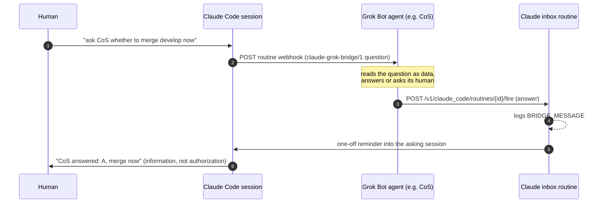

# claude-grok-bridge

**Claude Code and Grok Bot agents, talking to each other.** A Claude Code session can ask a
Grok Bot agent a question, relay a task its human typed, or send a note, and get the answer back
inside the same session, even with the laptop closed. A Grok Bot agent can answer, ack, or
escalate to its human first.

No relay server, no queue, no shared database. Each side calls the other through the vendor's
own automation endpoint:

- **Claude Code → Grok Bot:** the Grok agent's **routine webhook**.
- **Grok Bot → Claude Code:** one Claude Code **"inbox" routine**, run by the Grok agent through
  the Claude CLI it already has (or the documented routine fire API with a token). The inbox
  pushes the answer into the asking cloud session.

**Setup is one paste:** tell Claude Code "set up the grok bridge for CoS", paste the message it
prints to your Grok agent, done. The agent installs and wires both sides and runs a self-test.

## What is in the repo

| Path | What |
|---|---|
| `PROTOCOL.md` | `claude-grok-bridge/1`: envelopes (`question`, `request`, `note`, `answer`), statuses, trust rules |
| `SETUP.md` | setup: you paste one message to your Grok agent, everything else is automatic |
| `claude/skills/grok-bridge/` | Claude Code skill + `send_to_grok.py` |
| `claude/INBOX_ROUTINE.md` | the inbox routine (create body + prompt) |
| `grok/mcp_server.py` | Grok Bot custom connector **"claude-code"** (stdio MCP): `check_bridge`, `read_envelope`, `reply_to_claude` |
| `grok/reply_to_claude.py` | answers back to Claude: via the Claude CLI already on the box (no token) or a routine API token |
| `grok/BOOTSTRAP.md` | the one message you paste to your Grok agent |
| `grok/ROUTINE_PROMPT.md` | the Grok agent's "Claude Code bridge" routine |
| `examples/` | config and envelope samples |

## Trust model

- Answers are **information, not authorization**. A Claude Code session never treats an answer
  as approval for commits, merges, deploys or messages; it still asks its human. Pushed answers
  arrive as a system notification marked "not user input", prefixed
  `[grok-bridge reply <id>] [<agent>]`.
- A `request` (a task the human typed, "tell CoS to do X") carries the human's words verbatim.
  The Grok agent acts on it like a chat message from its owner, except for anything its own
  rules say needs explicit approval: then it answers `needs_confirmation` and asks the owner.
- Claude holds one narrow credential: the key that wakes one Grok routine. Grok answers through
  the Claude login it already has (or a token scoped to the inbox routine).
- The inbox routine only has the `Claude_Code_Remote` connector, and treats payloads as data.

## Status

Tested on 2026-10-19:
- Running the inbox routine with a payload (RemoteTrigger `run`, the call the Claude CLI makes),
  inbox logs `BRIDGE_MESSAGE`: works (about 8 s). Token-based fire API: documented, not yet run.
- Prompt injection inside a payload ("ignore previous instructions..."): ignored, logged as data.
- Inbox push into another cloud session via a one-off session reminder: works, arrives as a
  system notification (1 to 2 minutes, minute granularity).
- A cloud session finds its own id in `CLAUDE_CODE_REMOTE_SESSION_ID`.
- Not yet run: the Grok side end to end (bootstrap self-test).
- Not usable: `watch_url` inbound webhooks (their signing secret is sealed to Anthropic's artifact
  service).

Caveats: Claude Code routines are a research preview. The push step relies on session reminders
(`persistent_session_id`), which work but are not in the public routine docs; the run-log read
path is the documented fallback. Fires count against the Claude plan's usage: 30 per hour per
routine, 100 per hour per account. Claude.ai chat cannot take part (no outbound HTTP, no push
target); local Claude Code sessions can send, and read answers from the inbox.

## License

MIT
